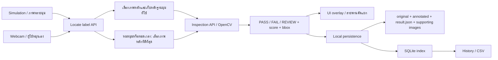

# Architecture และลำดับระบบ

## Frontend

app shell/pages ของ 01; features/simulation ของ 02; features/webcam ของ 04
แชร์ types และ API client เดียวกันใน apps/web ไม่สร้าง 3 เว็บแยกกัน
Simulation ต้องหยุดเมื่อออกหน้า; Webcam ต้องหยุด media tracks เมื่อออกหน้า

## Backend

API/routes/services/db ของ 04 เรียก pure inspection functions ของ 03
05 ทำข้อมูลและทดสอบ ทุกผลมี config_version และ client_request_id
STORAGE_ROOT อยู่เครื่องที่รัน Backend; hosting ไม่เขียน D: ฝั่งผู้ใช้โดยตรง

## Simulation states

IDLE → FEED → ORIENT → SETTLE → INSPECT → WAIT_RESULT → SORT → OUTPUT → COMPLETE
ORIENT วนมุมจริงที่อัปโหลดได้ไม่เกิน 360°/จำนวนภาพและ timeout
found usable view จึงหยุดหมุน; ฉลากผิดสินค้าที่มองชัดก็เป็น usable view ได้
หมดมุม/หมดเวลาให้ส่งภาพหลักและหลักฐานไป Inspection API เสมอ เพื่อบันทึกผลใน History
Backend ให้ REVIEW orientation_failed หากหลักฐานไม่พอ; frontend ไม่ตัดสิน FAIL หรือ REVIEW เอง
หากหลักฐานผ่าน required-view profile ที่ validate และยืนยันไม่มีฉลากได้จึงเป็น FAIL missing_label
จำนวนมุมหรือ reported_coverage_deg จาก client ไม่ถือเป็นการยืนยัน coverage
ภาพเดียวข้าม orientation search พร้อมข้อความ single-view ไม่สร้างด้านที่มองไม่เห็น
PAUSED หยุด clock; RESET ละทิ้ง job เก่า; ERROR หยุดสายงานไม่เดา PASS
route PASS → รับสินค้า; FAIL/REVIEW → คัดออก พร้อม reason ต่างกัน

## Webcam states

IDLE → REQUEST_PERMISSION → STREAMING → FIND_LABEL → HOLD_STILL → CAPTURE
→ INSPECT → SHOW_RESULT → READY_FOR_NEXT
ผู้ใช้หมุนขวดเอง ไม่มีการควบคุมวัตถุจริงจากภาพ 3D
locator throttled และมีคำขอค้างได้หนึ่งครั้ง; auto capture เป็นส่วนต่อยอด
manual capture ตรวจภาพปัจจุบันได้แม้ locator ยังไม่ usable แล้วให้ Backend ตัดสิน REVIEW ตามภาพ
การค้นหาหลายมุมต้องส่ง supporting_images และ evidence ตาม contract; มุมที่ไม่ทราบใช้ null

## Persistence states

inspection result กับ storage_status แยกกัน
pending → saved หรือ failed; retry ใช้ id เดิม; เก็บ partial write ที่กู้ได้อย่างมีสถานะ
ต้นฉบับไม่ถูกวาดทับ ภาพ annotated สร้างจาก original และ bbox ของภาพนั้น
supporting images ที่ใช้ตัดสินต้องถูกเก็บเสมอ เพื่อเปิดตรวจเหตุผล missing_label ย้อนหลังได้
SAVE_ROTATION_FRAMES ควบคุมเฉพาะเฟรมกลางทางที่ไม่ใช้เป็นหลักฐานในการตัดสิน
result.json เป็น immutable decision snapshot; SQLite เป็นข้อมูลล่าสุดของ storage/review
GET ประกอบ response จากคำตัดสินเดิมและสถานะล่าสุด ไม่แก้ prediction หลัง human review
